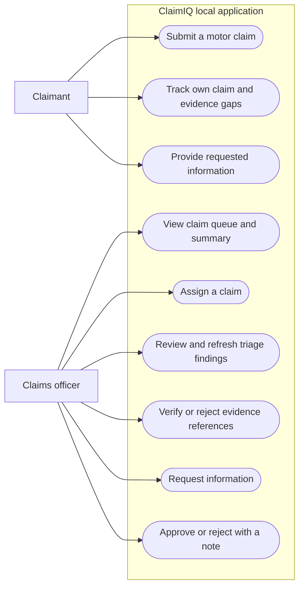
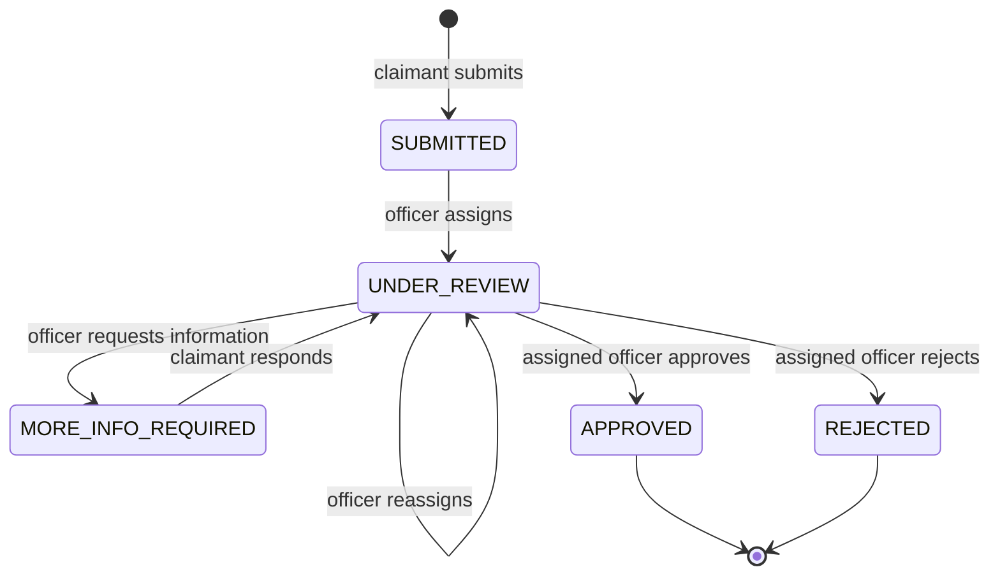
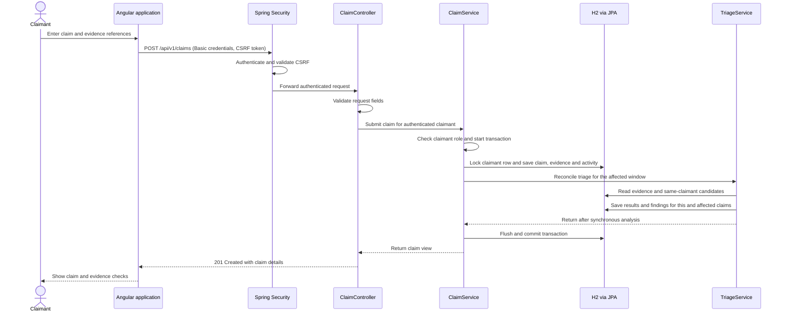
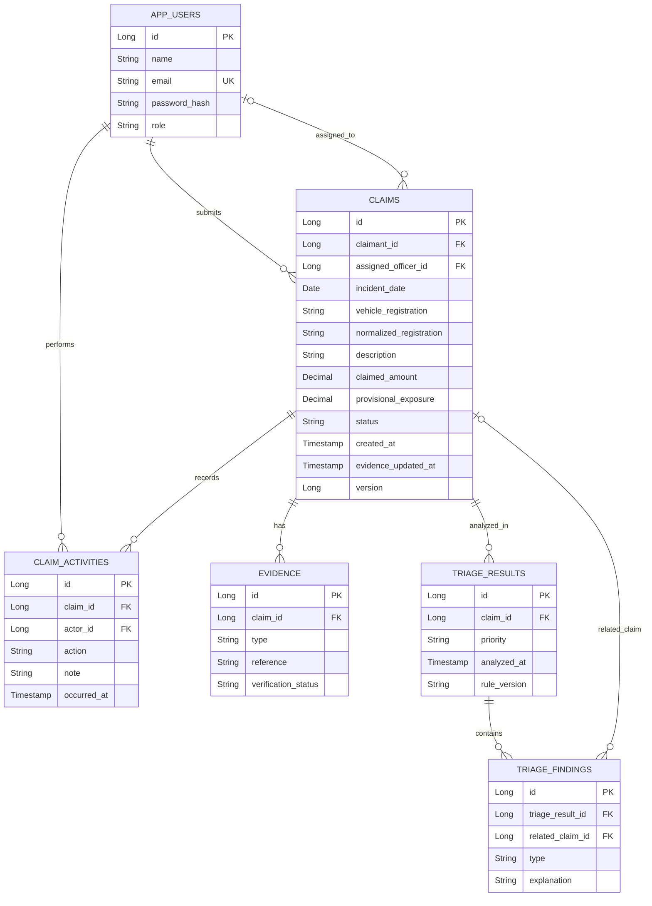

# ClaimIQ: use cases and technical design

This document describes the implemented motor-claims prototype. Diagrams use [Mermaid](https://mermaid.js.org/) syntax, supported by GitHub and many Markdown viewers. The application runs locally; Kafka, an LLM, file uploads and payments are not implemented.

## 1. System context and use cases

Both roles use the same Angular application. The claimant can access their own claims; the officer can review the queue. These use cases describe available behavior, not separate deployed services.

| Use case | Actor and condition | Outcome |
| --- | --- | --- |
| Submit claim | Authenticated claimant; valid incident date, vehicle registration, description and positive amount | Claim is saved as `SUBMITTED`; evidence references, activity and triage results are saved in the same transaction. |
| Track and respond | Claim owner; a response requires `MORE_INFO_REQUIRED` | The claimant sees their claim and evidence gaps. A response returns the claim to `UNDER_REVIEW` and reruns triage. |
| Manage the queue | Officer | The officer sees paginated claims and a summary of status counts and provisional exposure. |
| Assign and review | Officer; assignment requires `SUBMITTED` or `UNDER_REVIEW` | The claim becomes `UNDER_REVIEW`. The assigned officer can verify or reject evidence references. |
| Request information | Officer; claim must be `UNDER_REVIEW` | A note is recorded and status becomes `MORE_INFO_REQUIRED`. |
| Record decision | Assigned officer; claim must be `UNDER_REVIEW` | The officer records `APPROVED` or `REJECTED` with a note. There is no payment or settlement processing. |

All state-changing requests require CSRF protection. Claim updates carry an expected version; conflicting versions or invalid state transitions return HTTP 409. A claimant attempting to access another claimant's claim receives 404.

## 2. Claim lifecycle

`APPROVED` records an officer decision in this prototype; it does not represent settlement or payment. Evidence verification/rejection can occur while a claim is under review without changing its status.

## 3. Sequence: submitting a claim

This diagram starts after the user has signed in and the browser has obtained a CSRF token. It shows the synchronous implementation rather than a proposed event-driven system.

Validation or authorization failure prevents submission. Claim and triage changes share a transaction, so a failed transaction does not leave a partially submitted claim. The claimant-row lock serializes supported triage-writing operations for that claimant. The frontend requests the triage result separately; claimants receive evidence-gap findings only, while officers can see the other findings and overall operational priority.

## 4. Entity relationship diagram

The diagram shows the principal JPA entities and relationships. `APP_USERS` represents both claimants and officers. A claim has one claimant and at most one assigned officer. A triage finding may optionally point to another claim belonging to the same claimant under the current rules.

Evidence is metadata, not an uploaded document. A claim can have multiple result snapshots, and a result can contain multiple findings. The latest snapshot is selected by ID. Amounts use `BigDecimal`; currency is not currently modeled.

## 5. Engineering choices and boundaries

- **Modular monolith:** identity, security, claims and triage are package boundaries inside one Spring Boot application. This keeps the local assessment setup simple while separating responsibilities.
- **REST and future events:** REST handles the implemented synchronous actions. A future event-driven design could publish claim events via a transactional outbox and Kafka; neither exists in the current implementation.
- **Persistence:** file-backed H2 makes the demo easy to start. Hibernate schema updates and the registration backfill are prototype conveniences; production use would need a managed migration strategy and a suitable database.
- **Consistency:** optimistic claim versions prevent silent conflicting updates. A per-claimant pessimistic lock and synchronous one-hop reconciliation address the tested simultaneous-submission case; work grows with the number of claims in the affected window.
- **Human decision support:** explainable rules identify evidence gaps, same-date possible duplicates, recent same-vehicle claims and repeated narratives. Findings and priorities are review prompts, not proof of fraud, eligibility decisions or payout decisions.

See [README.md](README.md) for the project scope, [LOCAL_SETUP.md](LOCAL_SETUP.md) for a runnable walkthrough, and [API_REFERENCE.md](API_REFERENCE.md) for endpoint contracts.
